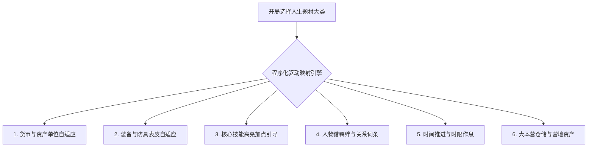

# 《蘑菇灯沉浸跑团》版本迭代与全题材架构规范 (V1.0)

> **版本**：Universal 2.0 -> V1.0 全题材人生模拟器架构规范  
> **文档定位**：系统设计标准与未来版本升级路线图  
> **核心设计理念**：**《多重人生模拟器 (Life Simulator) + PF1e 规则决断引擎》**  
> **核心工程原则**：**拒绝玄学提示词，100% 由本地程序确定性驱动 (Program-Driven)**

---

## 一、 系统架构升华与设计理念

传统跑团往往受限于中世纪西幻或单一武侠框架，一旦涉足现代职场、后宫权谋、末世屯粮或谍战等题材，容易在 UI 表皮与数值术语上产生强烈割裂（如后宫娘娘揣着“15 GP 金币”、都市青年穿着“皮甲拿着长剑”）。

**V1.0 架构核心突破**：
1. **程序驱动解耦**：彻底摒弃“让大模型在提示词里碰运气揣摩世界观”的做法，开局通过程序化大类按钮（后宫、现代、末世、江湖、谍战）锁定当前战役模式。
2. **表皮与规则分离**：
   - **底层（Under the Hood）**：严格遵循纯正的 Pathfinder 1e（开拓者一版）核心数值体系（六维属性调整值、DC 检定、豁免检定、技能加值、AC 护甲等级）；
   - **表层（Presentation Layer）**：由前端 JavaScript 与后端 Python 字典自动将“金币 (GP)”映射为银两/元/罐头/大洋，将防具武器映射为常服/防身器械，将人物好感映射为恩宠/怀疑度/信任度。
3. **人生模拟器形态**：
   玩家在不同历史与未来时空中体验一段完整人生，面对命运转折关头，凭借个人能力与随身信物作出分支决断，由冷峻客观的骰子判定成败。

---

## 二、 核心五大人生题材大类与程序化驱动字典

### 1. 👸 【宫闱后宫 · 步步惊心】（后宫 / 权谋逆袭 / 宠妃宫斗）
- **适用场景**：冷宫废妃复仇、御前掌事姑姑、步步为营母仪天下、世家贵女入宫选秀。
- **程序化货币**：`两 (白银)`、`文 (铜钱)`（自动换算：1 GP = 1 两白银）。
- **程序化装备**：
  - 防具映射：`素雅宫装 / 贴身金丝软绸内衬`（等价皮甲 AC 12~13）。
  - 武器映射：`淬毒翡翠凤簪 / 袖中薄刃 / 护甲银套`（1d4 穿刺）。
- **核心技能高亮**：`察言观色`（微表情分析）、`唬骗`（伪作温顺）、`医疗`（验毒识草药）、`手上功夫`（暗中藏药）、`交涉`（拉拢宫人）。
- **人物关系词条**：`恩宠度 / 把柄`、`戒备心理`、`结盟阵营`。
- **时间推进制式**：宫廷十二时辰制（如：`⏳ 卯正二刻 · 晨昏省膳`、`⏳ 戌初 · 宫门落锁`）。
- **大本营仓储**：`寝殿妆奁私库`。
- **战斗呈现**：**坚决封印战棋沙盘**，全流程采用高密度文学心理博弈与致命动作投骰对抗。

---

### 2. 🏙️ 【现代都市 · 逆袭商战】（现代职场 / 底层创业 / 悬疑刑侦 / 考研高考）
- **适用场景**：大厂裁员反戈一击、深夜小餐馆创业、经侦刑警暗访、高三高考全省冲刺。
- **程序化货币**：`元 (¥ 人民币 / 微信零钱 / 银行存款)`（自动换算：1 GP = 100 元）。
- **程序化装备**：
  - 防具映射：`高定抗污风衣 / 贴身防刺轻质内衬`（AC 12）。
  - 武器映射：`合金战术防身笔 / 破窗折叠刀 / 沉重手提箱`（1d4 钝击/穿刺）。
- **核心技能高亮**：`交涉`（商业谈判）、`察言观色`（职场读心）、`估价`（成本财务测算）、`隐匿`（收集机密黑料）、`解除装置`（黑客入侵/防盗锁）。
- **人物关系词条**：`人情 / 商业信用`、`利益捆绑 / 债务关系`。
- **时间推进制式**：现代 24 小时制（如：`⏳ 08:30 · 早高峰通勤`、`⏳ 21:45 · 加班复盘`）。
- **大本营仓储**：`合租单间 / 办公室资产库`。

---

### 3. ❄️ 【天灾末世 · 避难屯粮】（极寒暴雪 / 丧尸围城 / 废土拾荒 / 避难所经营）
- **适用场景**：全球冰封前 72 小时疯狂扫货、末日丧尸爆发防守地下避难所、废土避难营地。
- **程序化货币**：`高热量罐头`、`抗生素`、`安全区交易点券`。
- **程序化装备**：
  - 防具映射：`耐磨防撕裂防寒服 / 战术凯夫拉背心`（AC 14）。
  - 武器映射：`加重破拆撬棍 / 消防斧 / 工兵铲`（1d8 钝击/挥砍）。
- **核心技能高亮**：`生存`（极寒耐受与辨识）、`察觉`（预判尸潮埋伏）、`医疗`（抗生素清创）、`运动`（攀爬翻越断桥）、`解除装置`（柴油发电机检修）。
- **人物关系词条**：`信任度 (防背刺)`、`战斗默契 / 资源依赖`。
- **时间推进制式**：天数与灾变倒计时（如：`⏳ 第 1 天 · 距离极寒冰封还剩 48 小时`）。
- **大本营仓储**：**`地下避难所大本营仓库`**（解除个人负重暴毙 Bug，支持推车皮卡批量转存）。

---

### 4. 🏮 【传统江湖 · 问道大唐】（正统古典 / 武侠恩仇 / 捕快断案 / 镖局走镖 / 仙侠修真）
- **适用场景**：汴京开封府三等捕快密探首富案、龙门镖局押镖、纯正盛唐游侠修真。
- **程序化货币**：`两 (碎银)`、`文`、`贯`。
- **程序化装备**：
  - 防具映射：`素青云纹道袍 / 贴身金丝软甲`（AC 13）。
  - 武器映射：`百炼精钢剑 / 飞刀暗器 / 乌木折扇`（1d8/1d4）。
- **核心技能高亮**：`察觉`、`特技`（轻功身法）、`察言观色`、`辨识法术`（真气道法）、`威吓`。
- **人物关系词条**：`门派同道 / 江湖声誉`、`宿命羁绊 / 杀父仇怨`。
- **时间推进制式**：古典天色与时辰（如：`⏳ 申正 · 斜阳晚照`、`⏳ 子夜 · 宵禁巡城`）。
- **大本营仓储**：`宗门厢房 / 镖局后堂`。

---

### 5. 🕵️ 【民国谍战 · 潜伏暗战】（民国上海滩 / 76号特工 / 租界孤岛 / 地下交通站）
- **适用场景**：汪伪特工总部电讯科副科长代号“孤鹜”、霞飞路咖啡馆密送布防图、锄奸暗杀。
- **程序化货币**：`大洋 (块)`、`法币`、`小黄鱼 (金条)`。
- **程序化装备**：
  - 防具映射：`深灰呢子防风大衣 / 丝绒常服`（AC 12）。
  - 武器映射：`消音勃朗宁手枪 (备弹7发) / 隐秘毒针 / 钢丝绞索`（1d6 穿刺）。
- **核心技能高亮**：`唬骗`（假面应付）、`伪装`（变装易容）、`察言观色`（微表情审讯）、`隐匿`、`手上功夫`（偷换密电）。
- **人物关系词条**：`怀疑度 (危险红线 %)`、`秘密接头暗号 / 忠诚`。
- **时间推进制式**：民国时间与行动时限（如：`⏳ 1940年秋 · 22:30 宵禁警戒`）。
- **大本营仓储**：`霞飞路秘密安全屋 / 暗格电台`。

---

## 三、 已完成的底层加固与技术清单

| 模块 | 改进内容 | 收益 |
| :--- | :--- | :--- |
| **安全防御** | 封堵 `/api/save` 与 `/api/load` 路径遍历漏洞，强制执行 `sanitize_save_filename` | 杜绝任意 JSON 覆盖与目录越权 |
| **通信健壮性** | 前端流式引入 `sseBuffer` 切片缓冲池，解决网络跨包分包断裂 | 彻底根除大模型长篇输出时的丢字/漏字 |
| **XSS 防御** | 前端对白注入 `escapeHtml` 实体转义层 | 防止对白原生标签引发的 DOM 注入风险 |
| **状态机净化** | 开启新故事时彻底清空 `npc_roster`、`chronicles`、`campaignArc` 并重置时间 | 彻底消除跨战役人物与旧剧情串场 Bug |
| **AI 人设千人千面** | 引入多题材离线随机池与双保险 API Key 鉴权，提升 `temperature: 0.9` | 告别千篇一律单一模板，实现多样化生平与信物 |
| **顶栏响应式** | 顶栏 60px 高度硬锁定，`.header-actions` 防折行，时间徽章智能省略加 title 气泡 | 在各分辨率及长时辰下排版永不崩塌变形 |

---

## 四、 下阶段执行落地计划 (Next Steps)

1. **开局人生分类自选模态框**：在点击【🔄 开启新故事】时弹窗选择上述五大类（带一键快捷载入默认模板）。
2. **表皮映射全局注入器**：在前端 `state` 挂载 `themeConfig`，动态驱动货币符号、初始装备名称、技能加点提示和关系谱标签。
3. **避难所/大本营资产面板**：为末世及经营题材开辟第二存储空间，支持负重自由转移。
